  

  

 

   WHOAMI: Drack112, backend software developer (Python, NodeJS, Golang, hexagonal architecture, integrative AI services). C:\> STACK.EXE /ALL" width="100%" />

 

<h3 align="center"><samp>💾 A:\PROJECTS&gt; DIR</samp></h3>

  💾 <a href="https://github.com/Drack112/Golang-SimpleBank"><b>Golang-SimpleBank</b></a> <samp>★7</samp> 
  <samp>Bank API master class with DDD &amp; TDD — Go · Gin · gRPC · PostgreSQL · Redis · Traefik · CI/CD</samp>  
  💾 <a href="https://github.com/Drack112/Go-Wallpaper"><b>Go-Wallpaper</b></a> <samp>★20</samp> 
  <samp>Wallpaper scraper — Go · Colly</samp>  
  💾 <a href="https://github.com/Drack112/All-In-One-Music-Graphql"><b>All-In-One-Music-Graphql</b></a> 
  <samp>YTMusic, SoundCloud, Last.fm &amp; lyrics in one place — Next.js · GraphQL · Drizzle · Turso · Redis</samp>  
  💾 <a href="https://github.com/Drack112/Vintage-TUI-Radio"><b>Vintage-TUI-Radio</b></a> 
  <samp>Terminal radio streaming via ffmpeg — Go · Bubble Tea</samp>  
  💾 <a href="https://github.com/Drack112/Twitter-Spring-React"><b>Twitter-Spring-React</b></a> 
  <samp>Twitter-like microservices — Spring Boot · Eureka · Kafka · RabbitMQ · Prometheus · Grafana · Zipkin</samp>  
  💾 <a href="https://github.com/Drack112/Track-API"><b>Track-API</b></a> 
  <samp>Tracking API with full observability — Go · OpenTelemetry · Prometheus · Grafana · Zipkin</samp>  
  💾 <a href="https://github.com/Drack112/Car-Check-gRPC"><b>Car-Check-gRPC</b></a> 
  <samp>Car rental built on gRPC microservices — NestJS · gRPC · MongoDB</samp>  
  💾 <a href="https://github.com/Drack112/Namu-Api-Python"><b>Namu-Api-Python</b></a> 
  <samp>API with LLM integrations — FastAPI · SQLAlchemy · Anthropic · Ollama</samp>  
  💾 <a href="https://github.com/Drack112/Google-Docs-Flutter"><b>Google-Docs-Flutter</b></a> <samp>★5</samp> 
  <samp>Google Docs remake — Flutter · Socket.io · MongoDB</samp>  
  💾 <a href="https://github.com/Drack112/Discord-App-Next"><b>Discord-App-Next</b></a> 
  <samp>Discord clone: API, websocket &amp; WebRTC in one app — Next.js · LiveKit · Prisma · Clerk</samp>

 

<samp>· ˚ ✦ · ˚ ✦ · ˚ ✦ · ˚ ✦ · ˚ ✦ · ˚ ✦ ·</samp>

  
  
  
  
  
   
  
  
  
  

  <samp>you are visitor no.</samp> 
  

 

  

  
  &nbsp;
  
  &nbsp;
  

  <samp>made with Notepad and lots of cookies 🍪</samp>

