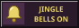
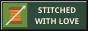
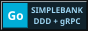
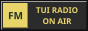
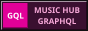
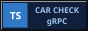

  

  
  &nbsp;
  

 

  

 

<samp>· ˚ ✦ · ˚ ✦ · ˚ ✦ · ˚ ✦ · ˚ ✦ · ˚ ✦ ·</samp>

  
  
  
  
   
  
  
  
  
  
  
  
  

  <samp>you are visitor no.</samp> 
  

 

  

  
  &nbsp;
  
  &nbsp;
  

  <samp>made with Notepad and lots of cookies 🍪</samp>

