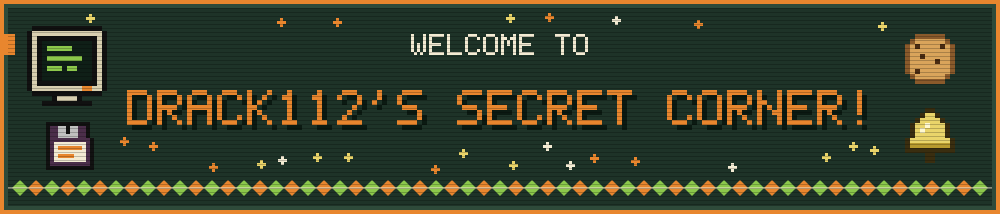
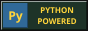
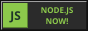
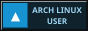
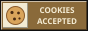

<p align="center">
  
</p>

<br>

<table width="100%">
<tr>
<td width="50%" valign="top">

<!-- LUCKYURO-START -->

```text
⠀⠀⠀⠀⠀⠀⠀⠀⠀⠀⠀⠀⠀⠀⠀⠀⠀⠀⠀⠀⣀⣠⣔⠒⢾⣋⣒⠒⠒⠖⠠⣄⡀⠀⠀⠀⠀⠀⠀⠀⠀⠀⠀⠀⠀⠀⠀
⠀⠀⠀⠀⠀⠀⠀⠀⠀⠀⠀⠀⠀⠀⠀⠀⢀⡔⠋⠉⠙⠁⠀⠀⢴⠉⠉⠉⠰⠢⡀⠈⠙⢦⡀⠀⠀⠀⠀⠀⠀⠀⠀⠀⠀⠀⠀
⠀⠀⠀⠀⠀⠀⠀⠀⠀⠀⠀⠀⠀⠀⠀⠀⢸⠃⣠⡀⢠⠤⢄⠀⢈⣣⣀⠀⠀⠀⠘⢢⡀⠠⡛⠆⠀⠀⠀⠀⠀⠀⠀⠀⠀⠀⠀
⠀⠀⠀⠀⠀⠀⠀⠀⡤⠒⠉⠉⠉⠱⢖⣤⡾⠿⠓⠋⠈⠉⠙⠓⠑⠮⣦⡤⡀⠀⠀⠀⢳⣠⣀⡜⠀⠀⠀⠀⠀⠀⠀⠀⠀⠀⠀
⠀⠀⠀⠀⢠⠒⢢⣸⠀⠀⠀⠀⠀⠀⢀⡴⠀⠀⠀⠀⠀⠀⠀⠀⠀⠀⠈⠙⢿⣆⠀⠀⢘⡿⠟⠓⠉⠉⠉⣉⣑⡲⣄⠀⠀⠀⠀
⠀⠀⠀⠀⠈⠑⠁⣷⠀⣠⣤⣄⡀⣰⠋⠀⠀⣀⡀⣀⡀⠀⠀⠀⠀⠀⠀⠀⢸⣿⣷⡶⠋⠀⠀⣀⣴⣾⣿⣿⣿⣿⣿⡇⠀⠀⠀
⠀⠀⠀⠀⠀⠀⠀⢸⣸⣿⣿⣿⣿⣇⣴⣾⣿⣿⣿⢺⣿⣷⣦⣄⠀⠀⠀⠀⠘⣿⠏⠀⠀⠠⡞⠋⣙⣻⣿⣿⣿⣿⣿⠃⠀⠀⠀
⠀⠀⠀⠀⠀⠀⡠⠊⢇⢿⣿⣿⣿⣿⣿⣿⣟⠁⠀⠀⢀⣿⣟⣻⣇⠀⠀⠀⠀⠁⠀⠀⢠⣮⣶⠟⠛⠛⠻⠿⣿⣿⠋⠀⠀⠀⠀
⠀⠀⠀⠀⠀⢠⡃⠀⠈⢿⣛⣿⣿⣿⣿⡟⠉⠛⠄⠀⠈⠻⠏⢿⣿⡇⠀⠀⠀⠀⠀⠀⢠⡿⠁⠀⠀⠀⠀⠀⠀⠈⢳⣀⣀⡀⠀
⠀⠀⠀⠰⣿⣾⡇⠀⠀⠀⠙⠿⣯⡿⣿⣇⠀⠀⠀⠀⠀⠀⠀⢸⣿⡿⣦⣀⣀⣀⣤⣴⠸⠇⠀⠀⠀⠀⠀⠀⣠⣼⣿⣿⣿⣿⠀
⠀⠀⠠⠶⢻⣿⣿⣦⣤⠀⠀⠐⢻⣟⣿⣏⠛⢶⣤⣤⣤⠔⡟⡏⠉⢳⡙⣧⢨⡙⣯⡏⠁⠀⠀⠀⢠⣶⢿⣿⣿⣿⣿⣿⡛⠻⠃
⠀⠀⠀⠀⢀⠽⠿⠛⠁⠀⠀⠀⠈⣿⣍⣿⡲⣤⣀⣠⣽⢡⣷⡇⠀⣀⡙⠉⣇⣿⢹⠀⠀⢀⠏⠑⠻⠿⠿⣿⣿⣿⣿⠟⢿⣦⡀
⠀⠀⠀⢰⠁⠀⠀⠀⠀⠀⠀⠀⠀⣿⠶⠿⠧⢤⡀⠀⡘⣌⣧⡷⠋⠉⠉⠙⠪⢿⣿⣄⠀⢹⢄⠀⠀⡠⠔⠚⠙⠛⠋⢄⠀⠛⠃
⠀⠀⠀⠘⣷⡖⠀⠀⢀⣰⠖⠈⠉⠉⠉⠉⠒⠢⢌⣻⣾⢚⣿⠟⠻⣦⡀⠀⠀⠘⣌⣿⢧⣜⣼⡂⢸⡀⠀⠀⠀⠀⠀⠀⢇⠀⠀
⠀⠀⠀⠀⠈⠉⠓⠚⢻⢇⣀⠀⠀⠀⠀⠀⠀⠀⠀⢹⣿⡶⠓⠢⡄⠀⠹⣦⡀⠀⠐⢏⠳⣅⣈⣳⡸⣅⠀⠀⢠⣄⠰⢤⠜⠀⠀
⠀⠀⠀⠀⠀⠀⠀⣠⢾⡄⠈⠉⠓⠒⠶⠶⠶⠒⠒⡾⣿⠓⣄⠀⠘⣆⠀⠈⢻⣦⡀⠈⠓⠛⠤⠬⣇⠈⠓⠤⠼⠥⠔⠊⠀⠀⠀
⠀⠀⠀⠀⠀⠀⣰⣣⣾⠥⣀⣀⠀⠀⠀⢀⣀⣠⡜⡹⢸⠀⠹⡄⠀⠀⠉⢢⣼⡇⠘⠦⡀⠀⠀⠀⠙⡄⠀⠀⠀⠀⠀⠀⠀⠀⠀
⠀⠀⠀⠀⠀⢀⡇⢀⡇⠀⠀⠉⠉⠉⠉⠉⠉⢹⠟⢁⡎⠀⠀⠘⣄⣠⣴⣿⣻⣿⠒⠤⠷⣻⣟⡩⡉⣧⡀⠀⠀⠀⠀⠀⠀⠀⠀
⠀⠀⠀⠀⠀⠈⣷⠒⣇⠀⣀⣀⣀⣤⠤⠤⠤⢿⣴⣋⣀⣀⣴⣿⠿⠛⠛⠋⠽⣿⣦⠀⠀⠉⠉⠁⠉⠀⠉⠦⡀⠀⠀⠀⠀⠀⠀
⠀⠀⠀⠀⠀⡜⡹⢀⣹⡍⠉⠀⠀⠀⠀⠀⠀⡨⡇⠀⠉⠉⠻⣽⠄⠀⠀⠀⠀⠈⢻⣷⡒⠒⢄⠤⠤⠤⣒⡤⠬⠦⡄⠀⠀⠀⠀
⠀⠀⠀⠀⡰⢹⠉⠁⣾⠑⠒⠒⠒⠲⠶⠒⣋⡴⠁⠀⠀⠀⠀⢸⠁⠀⠀⠀⠀⠀⠀⠈⢷⡖⠒⠚⠙⠙⠁⠉⠉⠒⠊⣆⠀⠀⠀
⠀⠀⠀⡔⠅⢺⡀⢀⣙⣷⣦⣤⡄⠴⣖⡛⠉⠀⠀⠀⠀⠀⠀⠀⠀⣀⢀⣀⣀⣀⣀⡄⠘⣿⢆⣤⠀⠀⠀⡀⠀⠀⠀⠹⡆⠀⠀
⠀⠀⠀⡏⠀⠴⢭⡉⠀⠀⠀⠀⣀⣴⠿⠟⠶⣤⣤⢠⡤⢖⣵⣿⠯⡼⠋⠛⠀⠀⠉⣛⣳⢿⠘⢷⡀⠈⢹⣌⠀⠀⡔⠠⣹⠀⠀
⠀⢀⠎⣀⠀⣄⠀⠙⢳⢺⠋⠋⢹⠃⠀⠀⠀⠀⠛⠓⢶⣿⣫⠋⠀⠀⠀⠀⠀⠀⠀⠀⠀⡿⠀⠀⠉⢷⡜⠈⠑⠦⣿⢤⣀⢣⠀
⠀⠮⠖⠛⠾⠹⢞⣠⠇⡜⠀⠰⡏⠀⠀⠀⠀⠀⠀⠀⣼⡏⠈⠀⠀⠀⠀⠀⠀⠀⠀⠀⠀⣶⡤⠳⢄⠀⡇⠀⠀⠀⠘⠢⠏⠛⠀
⠀⠀⠀⠀⠀⠀⠈⠁⠀⠱⠔⢹⠁⠀⠀⠀⠀⠀⠀⠀⣿⣇⡆⠀⠀⠀⠀⠀⠀⠀⠀⠀⠀⣿⠀⠀⠀⠓⠃⠀⠀⠀⠀⠀⠀⠀⠀
⠀⠀⠀⠀⠀⠀⠀⠀⠀⠀⠀⠈⠀⠀⠀⠀⠀⠀⠀⠀⣿⡿⡇⠀⠀⠀⠀⠀⠀⠀⠀⠀⠀⣿⠀⠀⠀⠀⠀⠀⠀⠀⠀⠀⠀⠀⠀
⠀⠀⠀⠀⠀⠀⠀⠀⠀⠀⠀⣾⠀⠀⠀⠀⠀⠀⠀⠀⢿⣿⡇⠀⠀⠀⠀⠀⠀⠀⠀⠀⢲⠇⠀⠀⠀⠀⠀⠀⠀⠀⠀⠀⠀⠀⠀
⠀⠀⠀⠀⠀⠀⠀⠀⠀⠀⠀⣿⠀⠀⠀⠀⠀⠀⠀⠀⢸⣧⢸⠀⠀⠀⠀⠀⠀⠀⠀⠀⣿⠀⠀⠀⠀⠀⠀⠀⠀⠀⠀⠀⠀⠀⠀
⠀⠀⠀⠀⠀⠀⠀⠀⠀⢀⣼⠅⠀⠀⠀⠀⠀⠀⠀⠀⠈⠙⠀⠀⠀⠀⠀⠀⠀⠀⠀⠀⠹⡄⠀⠀⠀⠀⠀⠀⠀⠀⠀⠀⠀⠀⠀
⠀⠀⠀⠀⠀⠀⠀⠀⡰⠛⠀⠀⠀⠀⠀⠀⠀⠀⠀⠀⠀⠀⠀⣳⡆⠀⠀⠀⠀⠀⠀⠀⠀⠻⡄⠀⠀⠀⠀⠀⠀⠀⠀⠀⠀⠀⠀
⠀⠀⠀⢀⣠⣤⣤⣾⠁⠀⠀⠀⠀⠀⠀⠀⠀⠀⠀⠀⠀⠀⣜⣿⠘⠀⠀⠀⠀⠀⠀⠀⠀⠀⣷⠀⠀⠀⠀⠀⠀⠀⠀⠀⠀⠀⠀
⠀⠀⡰⠃⠀⠀⢸⡃⠀⠀⠀⠀⠀⠀⠀⠀⠀⠀⠀⠀⠀⢰⣿⡿⡸⠀⠀⠀⠀⠀⠀⠀⠀⠀⢹⡇⠀⠀⠀⠀⠀⠀⠀⠀⠀⠀⠀
⢠⠋⠀⠀⠀⠀⠀⠀⠀⠀⠀⠀⠀⠀⠀⠀⠀⠀⠀⠀⠀⣼⡿⢁⣃⣀⠀⠀⠀⠀⠀⠀⠀⠀⠀⣷⠀⠀⠀⠀⠀⠀⠀⠀⠀⠀⠀
⣸⠀⠀⠀⠀⠀⠀⠀⠀⠀⠀⠀⠀⠀⠀⠀⠀⠀⡠⠒⠋⠁⠀⠀⠀⠀⠉⠳⢄⡀⠀⠀⠀⠀⠀⣽⠀⠀⠀⠀⠀⠀⠀⠀⠀⠀⠀
⢿⠀⠀⠀⠀⠀⠀⠀⠀⠀⠀⠀⠀⠀⠀⠀⣠⡾⠀⠀⠀⠀⠀⠀⠀⠀⠀⠀⠀⠘⢦⠀⠀⠀⢠⡏⠀⠀⠀⠀⠀⠀⠀⠀⠀⠀⠀
⠈⠳⢄⡀⢀⡔⠀⠀⠀⠀⠀⠀⠀⠀⣀⠎⢹⠃⠀⠀⠀⠀⠀⠀⠀⠀⠀⠀⠀⢠⣬⠀⠀⢀⡼⠀⠀⠀⠀⠀⠀⠀⠀⠀⠀⠀⠀
⠀⠀⠀⠉⠙⠓⠢⠒⠢⣄⣀⣤⠴⠋⠁⠀⢸⣾⣦⣀⠀⠀⠀⠀⠀⠀⠀⣀⣴⣿⣿⠀⢀⡾⠁⠀⠀⠀⠀⠀⠀⠀⠀⠀⠀⠀⠀
⠀⠀⠀⠀⠀⠀⠀⠀⠀⠀⠀⠀⠀⠀⠀⠀⠀⢿⣿⣿⣿⣶⣶⣶⣶⣾⣿⣿⣿⣿⣧⡴⠛⠁⠀⠀⠀⠀⠀⠀⠀⠀⠀⠀⠀⠀⠀
⠀⠀⠀⠀⠀⠀⠀⠀⠀⠀⠀⠀⠀⠀⠀⠀⠀⠀⠙⢿⣿⣿⣿⣿⣿⣿⣿⠿⠛⠋⠁⠀⠀⠀⠀⠀⠀⠀⠀⠀⠀⠀⠀⠀⠀⠀⠀
⠀⠀⠀⠀⠀⠀⠀⠀⠀⠀⠀⠀⠀⠀⠀⠀⠀⠀⠀⠀⠀⠈⠉⠉⠉⠀⠀⠀⠀⠀⠀⠀⠀⠀⠀⠀⠀⠀⠀⠀⠀⠀⠀⠀⠀⠀⠀
```

<!-- LUCKYURO-END -->

</td>
<td width="50%" valign="top" align="center">

<h3 align="center">✦ Luckyuro's Secret Corner ✦</h3>

<p align="center">
  <samp>
    Backend software developer focused on<br>
    Python, NodeJS and Golang, working with<br>
    hexagonal architecture and integrative<br>
    AI services.
  </samp>
</p>

<p align="center"><samp>· ˚ ✦ · ˚ ✦ · ˚ ✦ · ˚ ✦ ·</samp></p>

<details align="center">
<summary><b><samp>🍪 Open the cookie purse</samp></b> </summary>

<h3 align="center"><samp>L U C K Y &nbsp;! 🔔</samp></h3>

<p align="center"><samp><b>🎃 Languages</b></samp></p>
<p align="center">
  
  
  
  
  
  
</p>

<p align="center"><samp><b>🧶 Backend</b></samp></p>
<p align="center">
  
  
  
  
  
  
  
  
  
  
  
</p>

<p align="center"><samp><b>🎀 Frontend &amp; Mobile</b></samp></p>
<p align="center">
  
  
  
  
  
  
  
</p>

<p align="center"><samp><b>🔔 APIs &amp; Messaging</b></samp></p>
<p align="center">
  
  
  
  
  
  
  
</p>

<p align="center"><samp><b>🍪 Databases &amp; ORMs</b></samp></p>
<p align="center">
  
  
  
  
  
  
  
  
  
  
  
  
  
</p>

<p align="center"><samp><b>✨ AI &amp; LLMs</b></samp></p>
<p align="center">
  
  
  
  
  
</p>

<p align="center"><samp><b>📡 DevOps &amp; Observability</b></samp></p>
<p align="center">
  
  
  
  
  
  
  
  
  
  
</p>

<p align="center"><samp><b>☁️ Cloud &amp; Services</b></samp></p>
<p align="center">
  
  
  
  
  
  
  
  
</p>

<p align="center"><samp><b>🧪 Testing &amp; Tooling</b></samp></p>
<p align="center">
  
  
  
  
  
  
</p>

<p align="center"><samp><b>🪡 Dev Setup</b></samp></p>
<p align="center">
  
  
  
  
  
  
  
  
</p>

</details>


<p align="center"><samp>· ˚ ✦ · ˚ ✦ · ˚ ✦ · ˚ ✦ ·</samp></p>

<p align="center">
  <a href="https://drack112.vercel.app/"></a>
  
  
  <br>
  
  
  
  <br>
  
  
  
</p>

<p align="center">
  <samp>you are visitor no.</samp><br>
  
</p>

</td>
</tr>
</table>

<br>

<p align="center">
  
</p>

<p align="center">
  
  &nbsp;
  
  &nbsp;
  
</p>

<p align="center">
  <sub><samp>made with Notepad and lots of cookies 🍪</samp></sub>
</p>
